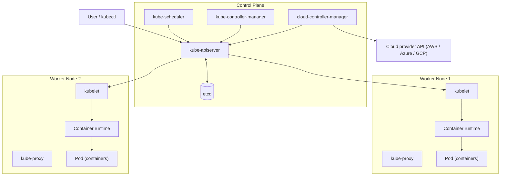
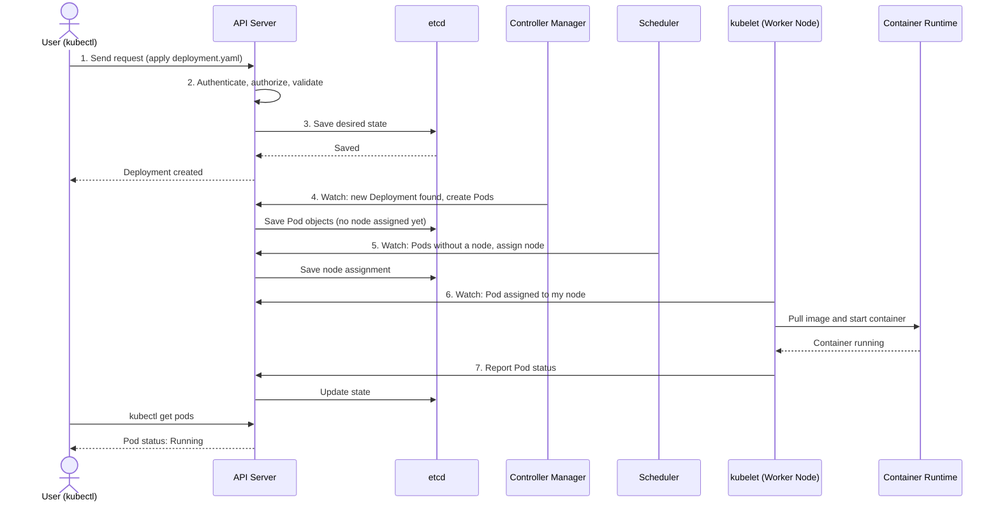

# Kubernetes Architecture

Kubernetes (K8s) is split into two parts: the **control plane**, which decides what should run and where, and the **worker nodes**, which actually run your applications.
 
## Architecture Diagram



## Control Plane Components

The control plane is the cluster's brain. It decides what should run and where, and it keeps checking that reality matches what you asked for.

| Component | What it does, in simple words |
|---|---|
| **kube-apiserver** | The front door. Every request goes through it, whether from `kubectl`, other components, or you. It checks who you are and whether you're allowed, then passes the request on. Nothing talks to anything else without going through it. |
| **etcd** | The cluster's database. It stores everything: what Pods exist, what you asked for, and what state they're in. If etcd is lost, the cluster forgets everything, so it is backed up carefully. |
| **kube-scheduler** | The matchmaker. When a new Pod needs a home, it picks the best node based on free CPU and memory and any rules you set. It only chooses the node. It doesn't start anything. |
| **kube-controller-manager** | The watchdog. It compares what you asked for ("3 copies") with what exists ("2 running") and fixes the gap by creating or replacing Pods. This is what makes self-healing work. |
| **cloud-controller-manager** | The cloud translator. It talks to your cloud provider (AWS, Azure, GCP) to create load balancers, attach disks, and manage nodes. It only exists on cloud-based clusters. |

## Worker Node Components

These run on every worker node and handle your actual workloads.

| Component | What it does, in simple words |
|---|---|
| **kubelet** | The node's manager. It receives instructions from the control plane and makes sure the containers for its Pods are running and healthy. |
| **kube-proxy** | The traffic router. It makes sure network requests sent to a Service reach the right Pods. |
| **Container runtime** (e.g. containerd) | The engine that pulls images and runs containers. |

## What Happens When You Run a `kubectl` Command

Example: `kubectl apply -f deployment.yaml`



**Step by step**

1. `kubectl` reads your YAML and sends it to the **API server**.
2. The API server verifies who you are and what you're allowed to do, then validates the request.
3. It saves the desired state in **etcd**.
4. The **controller manager** notices the new Deployment and creates the Pods needed.
5. The **scheduler** sees Pods with no node and assigns each one to a suitable node.
6. The **kubelet** on that node sees the assignment and tells the **container runtime** to pull the image and start the container.
7. The kubelet reports status back to the API server, which updates etcd. `kubectl get pods` then shows the result.

Note that components don't call each other directly. They all watch the API server for changes and act on them.

## Pod and Container

A **container** is your application packaged with its dependencies, the same thing you build with Docker.

A **Pod** is the smallest unit Kubernetes manages. It wraps one or more containers.

Think of a container as a person and a Pod as the apartment they live in. The Pod gives its containers:

- a **shared network address**, so they can reach each other on `localhost`
- **shared storage** (volumes)
- a shared lifecycle: they are scheduled, started, and stopped together

| | Container | Pod |
|---|---|---|
| **What it is** | A packaged, running application | A wrapper around one or more containers |
| **Created from** | A Docker image | A Pod spec (YAML) |
| **Managed by Kubernetes directly?** | No | Yes |
| **Has its own IP?** | No | Yes |

**Key points**

- Most Pods hold a **single container**. Multiple containers go in one Pod only when they are tightly coupled, such as an app plus a logging helper (a "sidecar").
- Pods are **temporary**. When one dies, Kubernetes replaces it with a new Pod that gets a new IP. For this reason you don't normally create Pods directly. Use a controller such as a **Deployment**, which keeps the right number of Pods running.

```
Deployment --> ReplicaSet --> Pods --> Containers
```

## Quick Reference

```bash
kubectl apply -f deployment.yaml   # create or update resources
kubectl get pods                   # list Pods
kubectl describe pod <pod>         # detailed Pod info and events
kubectl logs <pod>                 # container logs
kubectl exec -it <pod> -- sh       # shell inside a Pod
kubectl delete pod <pod>           # delete a Pod (a Deployment recreates it)
```
